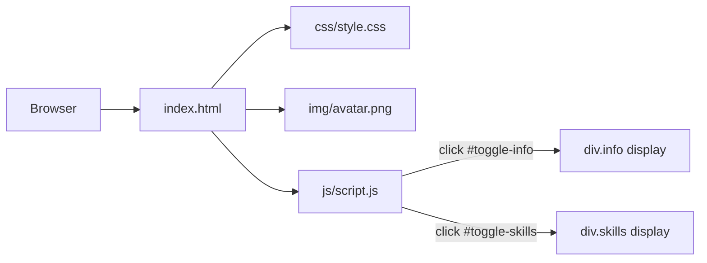

# tsiweb-app-dev - documentation

A static profile page: one HTML file, one stylesheet, one image and one script.
It was a first exercise of a web application development course at TSI in
October 2024 (`README.md:3-5`; commit `04faefa`, 2024-10-04). The card shows a photo, a name, three labelled
info lines and a skills list. Two buttons show and hide the info block and the
skills block (`index.html`, `js/script.js`). The code does not say who the page
is for beyond the course (see [Open questions](../SPEC.md#9-open-questions)).

The requirements are in [SPEC.md](../SPEC.md).

## Status

- Page content (`index.html`, `css/style.css`, `js/script.js`) last changed on
  2024-10-04 (commit `04faefa`, `git log -- index.html css js img`). On
  2026-11-08 commit `ceab5c2` moved `img/avatar.png` into Git LFS. Its message
  says existing files were renormalised, but its diff touches no page file
  other than the image (`git show --stat ceab5c2`).
- Every other commit since then (2026-11-08, up to `108fe26`, tagged `v1.0.0`)
  adds repository tooling, the README and `CLAUDE.md`.
- Tests: none for the page. `.claude/pytest.ini` exists, and pytest collects
  no tests (`python -m pytest .claude --collect-only -q`, exit 5, run on
  2026-11-18).
- CI: five Gitea workflows in `.gitea/workflows/`. Whether a runner serves this
  repository is not recorded (`CLAUDE.md:44-46` covers both cases).
- Unfinished: the README lists five lab requirements this repository does not
  meet: R-02, R-09, R-37, R-41, R-42, tracked as issues #7-#11 (`README.md:49`).
  Branch protection starts at stage 1 and moves to stage 2 once `propose` and
  `release-gate` have each run once (`CLAUDE.md:68-70`). The current stage is
  not recorded.
- The three later course exercises are kept only as tags `import/class1`,
  `import/lab1` and `import/lab2`, and none of them is built or tested
  (`README.md:23-34`). This document and `SPEC.md` cover the `release` branch only.

## Layout

| Path | What it is |
|---|---|
| `index.html` | The page: profile card, info block, skills list, two buttons |
| `css/style.css` | Layout and card styling (31 lines) |
| `js/script.js` | Click handlers that show and hide `.info` and `.skills` |
| `img/avatar.png` | The photo, PNG 960x1280 RGBA, 2,278,070 bytes, stored through Git LFS |
| `README.md` | What the repository holds, the tags, the lab compliance line |
| `CLAUDE.md` | Working rules for this repository |
| `LICENSE` | MIT, 2024 |
| `recipe.ps1`, `.claude/`, `.gitea/` | Repository tooling (see below) |

## Architecture

There is no server and no build step. A browser opens `index.html`, which loads
three files by relative path: `css/style.css` (`index.html:7`),
`img/avatar.png` (`index.html:12`) and `js/script.js` (`index.html:32`). No
external URL, font, CDN or library is referenced. The script waits for
`DOMContentLoaded` (`js/script.js:1`), then attaches one click handler to each
button. Each handler flips the inline `style.display` of its section between
`block` and `none` (`js/script.js:7-21`). Nothing is stored. A reload resets
both sections.



## Build and run

- Prerequisite: a web browser. No browser version is stated anywhere in the
  repository.
- A clone needs Git LFS to get the real `img/avatar.png`: `.gitattributes:9`
  routes `*.png` through LFS. Without it the file is a 132-byte pointer
  (`git show --stat ceab5c2`).
- Run: "Open `index.html` in a browser; nothing needs building" (`README.md:18`).

## Configuration

The page has no configuration: no environment variables, no config file, no
query parameters. `recipe.ps1:30-38` loads `.claude/.env`, if that file exists,
into the process environment, but none of this project's verbs reads an
environment variable (`recipe.ps1:40-74`).

## Usage

1. Open `index.html`. The card is centred on a grey background
   (`css/style.css:1-8`). The info block and the skills list are visible from
   the start, because no CSS rule hides them (`css/style.css`).
2. Click **Toggle Info** or **Toggle Skills** to hide or show the matching
   block. The first click on each button does not change what is shown (see
   limitation 1).
3. Repository metadata:

   ```
   PS> .\recipe.ps1 info
   Name    : tsiweb-app-dev
   Code    : tad
   Version : 1.0.0
   Summary : Coursework web pages from a TSI web application development course, 2024.
   ```

   Run on 2026-11-18, exit 0. Source: `recipe.ps1:56-62`, `README.md:39-40`.

## Testing

The page has no automated tests. `.\recipe.ps1 test` (`recipe.ps1:41-55`,
`README.md:38-39`) runs pytest, `ruff check` and `ruff format` over `.claude`
only. It treats pytest exit 5 ("no tests collected") as a pass
(`recipe.ps1:47-48`). It never opens the page, so it says nothing about the
HTML, CSS or JavaScript.

## Known limitations and problems

1. **The first click on each toggle does nothing visible.** At load time
   `style.display` is the empty string, because no inline style is set. The
   handler treats `''` like `'none'` and sets `'block'`, which the `div` already
   is (`js/script.js:8-9`, `js/script.js:16-17`). The section therefore hides on
   the second click. This follows from the code. It was not observed in a
   browser.
2. The hobby line has no space between its label and value
   (`index.html:17`). The nickname and dish lines have one
   (`index.html:16`, `index.html:18`).
3. `img/avatar.png` is 960x1280 and 2,278,070 bytes, and is shown at
   150x150 px (`css/style.css:22-27`).
4. The buttons carry no `aria-expanded` or `aria-controls` attributes
   (`index.html:29-30`).
5. `README.md:40` says that the verbs other than `test` and `info` print
   `nothing to <verb>`. `clean` actually deletes `__pycache__`,
   `.pytest_cache` and `.ruff_cache` directories and prints nothing
   (`recipe.ps1:63-68`).
6. The lab requirements link in `README.md:49` points to `http://127.0.0.1:3000/...`.
   It can only open on a machine that runs that server, not from GitHub.
7. The commit subject of `ceab5c2` says "pin ruff and pytest", but only ruff is
   pinned (`.claude/ruff.toml:2`, `==0.16.1`). `.claude/pytest.ini` holds no
   version constraint. No file installs either tool. On the machine where this
   document was written, `python -m ruff` reported "No module named ruff",
   so `.\recipe.ps1 test` would fail there at the ruff step.

## Repository tooling

This repository follows
[repo-quality-template](https://github.com/IGORSVOLOHOVS/repo-quality-template),
lab requirements revision 4.0.0 (`README.md:49`, merge commit `108fe26`).
The hooks, the workflows, the templates, `.gitattributes` and
`.claude/settings.json` are byte-identical to the template's `release` branch
(blob comparison on 2026-11-18). Specific to this repository:

- `recipe.ps1:9-20`: `$Name = 'tsiweb-app-dev'`, `$Code = 'tad'`,
  `$Version = '1.0.0'`. `$Needs`, `$Tools` and `$Provides` are empty. There is
  no `$App`, `$Entry`, `$Console`, `$Include` or `$Imports` ("nothing is
  installed"). `$CommitScopes` is `core, build, ci, docs, deps`.
- Verbs that do something: `test` (pytest + ruff over `.claude`), `info`
  (four metadata lines) and `clean` (deletes cache directories). `build`,
  `install`, `uninstall`, `run` and `publish` print `nothing to <verb>` and
  exit 0 (`recipe.ps1:69-73`; `run` checked on 2026-11-18).
- Deviations from the template's `recipe.ps1`: it calls `python -m` instead
  of `uv run --frozen`, runs no mypy, does no `pyproject.toml` version check,
  and sets `$ErrorActionPreference = 'Stop'` (the template has `'Continue'`).
- Files the template does not have: `.claude/pytest.ini` and `.claude/ruff.toml`.
- `.gitignore:28` adds `node_modules/` in place of the template's Python and
  IDE entries.
- Relaxations named by the owner: `CLAUDE.md:61-70`.

## Related documents

- [SPEC.md](../SPEC.md): requirements reverse-engineered from the code
- [README.md](../README.md): repository overview and the kept tags
- [CLAUDE.md](../CLAUDE.md): working rules
- [LICENSE](../LICENSE): MIT licence

## About this document

Written on 2026-11-18 from commit `108fe26` (branch `release`, tag `v1.0.0`).

Commands run: `git ls-files`, `git log`, `git tag`, `git ls-tree` on the three
`import/*` tags, `git diff --stat origin/main HEAD`, `git show --stat ceab5c2`,
`git check-attr -a img/avatar.png`, `.\recipe.ps1 info` and `.\recipe.ps1 run`
(both exit 0), `python -m pytest .claude --collect-only -q -p no:cacheprovider`
("no tests collected", exit 5), `python -m ruff --version` (module absent), and
a blob-hash comparison of the tooling files against the template's
`origin/release`.

Not run: `.\recipe.ps1 test`, which writes `core.hooksPath` into the git config
and formats files in place, and ruff is not installed here. Also not run:
`.\recipe.ps1 clean` and the Gitea workflows. The page was not opened in a
browser, so the behaviour in limitation 1 comes from reading the code.
